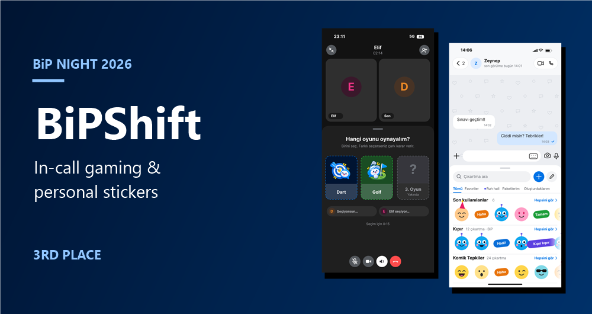
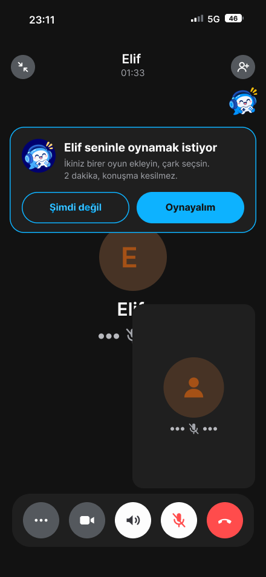
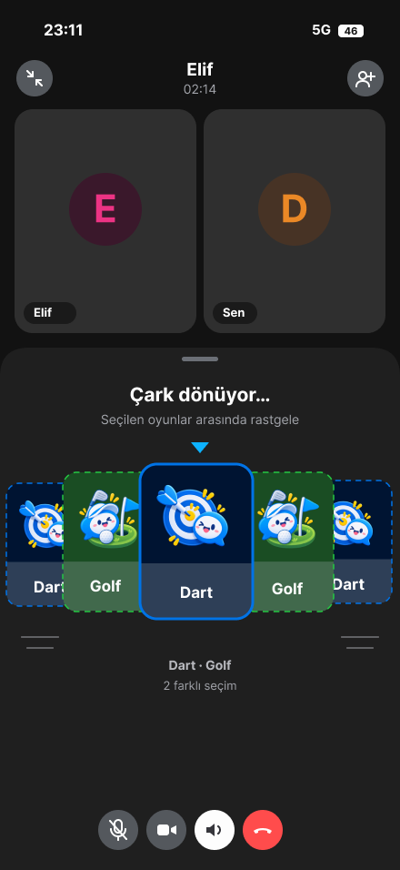
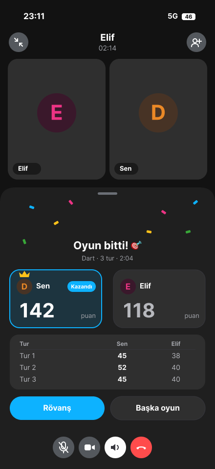
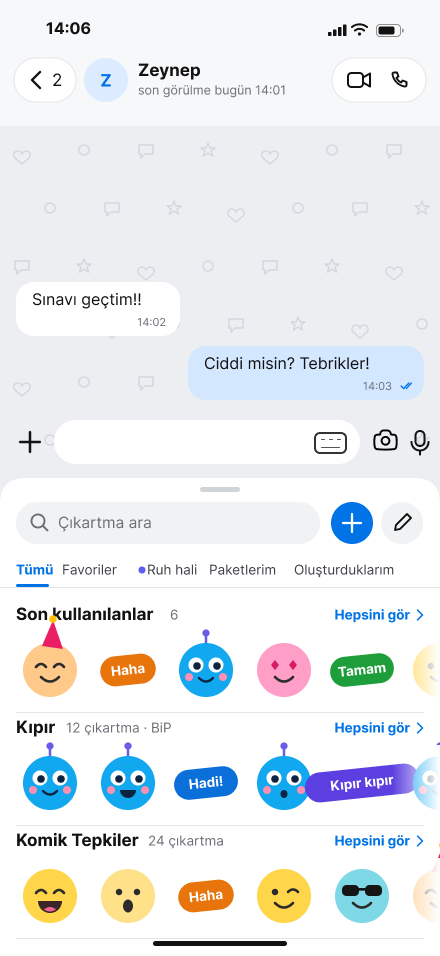
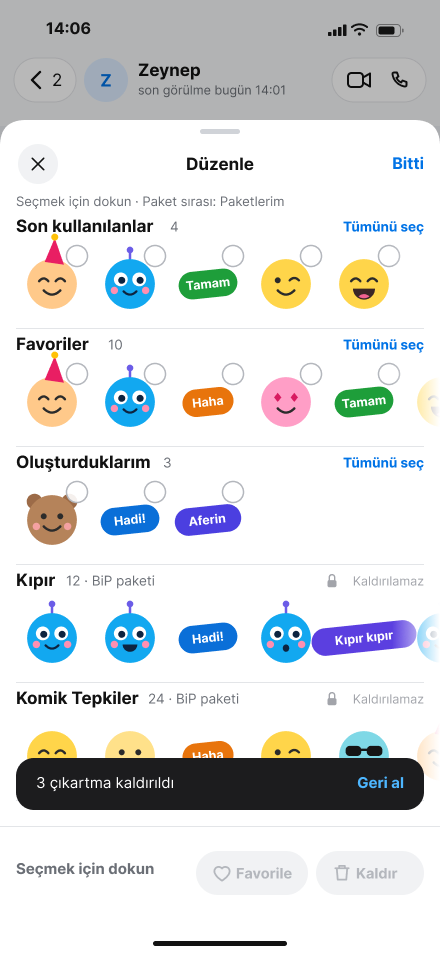
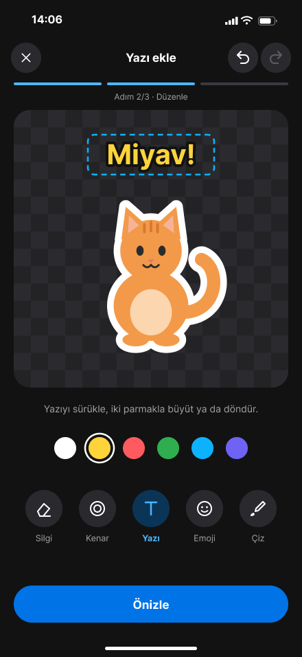

# BiPShift

**Play together during a call. Make conversations your own with stickers.**

**3rd Place** · Turkcell Geleceği Yazanlar BiP Night · November 16–17, 2026

**My role:** Team Leader & UI/UX Designer · **Design target:** BiP 5.6 for iOS

[Figma design](https://www.figma.com/design/CdAhym3hcVFWnrjJkG8poo/B%C4%B0PSHIFT?node-id=0-1) · [Screen exports](assets/) · [In-call gaming](#case-1a--in-call-gaming) · [Sticker experience](#case-1b--sticker-experience)

## Project overview

BiPShift is a collaborative design challenge entry that explores two ways to make BiP conversations more expressive. Case 1A adds a shared activity to a live call. Case 1B makes stickers easier to find, manage, and create within a chat. Both cases start from the same design principle: keep people oriented in the conversation while they do something new.

## The challenge

| Brief | Design question |
| --- | --- |
| **Case 1A · In-call gaming** | How can two people discover, agree on, and play a short game while staying connected to their call? |
| **Case 1B · Sticker experience** | How can someone find a sticker quickly, manage a collection, and make something personal from the chat? |

## Design principles

- **Reduce cognitive load.** Give each step one clear decision and make waiting states visible.
- **Preserve context.** Keep the call or conversation recognizable as people move into a game or sticker panel.
- **Reuse familiar interactions.** Build on call controls, chat sheets, taps, and swipes.
- **Simplify and personalize.** Keep browsing direct, make collection changes recoverable, and offer creative tools when people choose to use them.

## Case 1A — In-Call Gaming

### Discover and invite

A game entry point in the call opens an introduction and an invitation. The sender sees a pending state. The recipient can accept to move into game selection or decline and continue the call. BiPcan is the character used throughout the gaming experience.

[Call entry](assets/call-game-entry.png) · [Game introduction](assets/game-discovery.png) · [Pending invitation](assets/invite-sent.png)

### Choose and play

Both participants choose a game. A matching choice can move directly toward play. When preferences differ, a shared wheel breaks the tie and shows the selected game. The team explored Dart and Golf as short game concepts.

[Game selection](assets/game-selection.png) · [Different picks](assets/different-picks.png) · [Dart selection result](assets/dart.png) · [Golf screen](assets/golf.png)

### Stay oriented and return to the call

The designs keep call participants and controls in view during play. Chat indicators surface whose turn it is and whether the game has ended. The results screen shows a score breakdown and offers a rematch. The flow also considers returning to the call after play.

*Screen export pending for the [chat turn indicator](https://www.figma.com/design/CdAhym3hcVFWnrjJkG8poo/B%C4%B0PSHIFT?node-id=65-11409).*

## Case 1B — Sticker Experience

### Browse and manage

The sticker panel groups packs into horizontal rows and stacks those rows vertically. People can swipe within a pack or scroll down to another one. Five tabs organize the panel: **All**, **Favorites**, **Mood**, **My Packs**, and **My Creations**.

Edit mode supports selecting multiple stickers, marking eligible items as favorites, and removing them in bulk. A confirmation step precedes removal, and an undo action offers a way to recover afterward.

*Screen exports pending for [bulk selection](https://www.figma.com/design/CdAhym3hcVFWnrjJkG8poo/B%C4%B0PSHIFT?node-id=82-5164) and [removal confirmation](https://www.figma.com/design/CdAhym3hcVFWnrjJkG8poo/B%C4%B0PSHIFT?node-id=82-2073).*

### Create, preview, and send

Personal sticker creation moves from choosing a source image to automatic or freehand cutout. The editor lets people refine the cutout, add text, and preview the result before saving it to their collection or sending it in chat.

*Screen exports pending for the creation steps listed in the [export checklist](assets/README.md#pending-figma-exports).*

### Video-to-sticker concept

A separate Figma concept explores entering a video link, reviewing a proposed pack of moments, editing the selection, and adding the pack. These screens illustrate an interaction idea. Video processing, trend detection, and copyright clearance were outside the demonstrated design scope.

*Screen exports pending for the [video link entry and pack review](assets/README.md#pending-figma-exports).*

## Design decisions

| Decision | UX rationale |
| --- | --- |
| Invitation states before game selection | Both people can see what is happening and decide whether to play before choosing a game. |
| Wheel only when choices differ | A match needs no extra step. Different picks get a visible resolution both participants can follow. |
| Call controls and chat status stay visible | People have a reference point for the call, the current turn, and what they can do next. |
| Pack rows, tabs, and a separate edit mode | Browsing keeps its familiar shape while collection changes get dedicated controls. Confirmation and undo address accidental removal at different points in the flow. |
| Automatic and freehand cutout with preview | People can start quickly or define an outline themselves. Preview provides a chance to check the result before sharing. |

## My role and collaboration

I was **Team Leader & UI/UX Designer** for BiPShift. The cases, flows, and screens shown here are the team's collaborative work.

## Outcome

Our team placed **3rd** at the Turkcell Geleceği Yazanlar BiP Night UI/UX Design Challenge. The project documents design concepts and Figma screens. The team conducted no user testing or surveys and collected no measured performance results.

## Reflections

- When an optional activity starts inside a conversation, the waiting, decline, and return states deserve as much attention as the activity itself.
- Sticker browsing and sticker management serve different intentions. Giving collection changes their own mode makes it easier to design deliberate actions and recovery.
- A preview is a natural checkpoint in a creation flow because it lets people review what they are about to save or share.

## Credits

Design by the **BiPShift team**, created for **Turkcell Geleceği Yazanlar BiP Night 2026**. BiPShift is a collaborative hackathon design concept. It is unaffiliated with any official BiP release. The cover uses the team's Figma screen exports.
